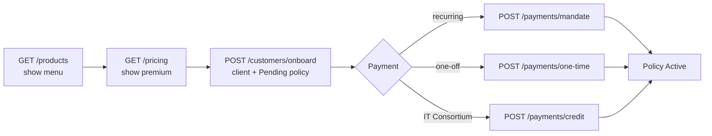

# Equity Health Insurance USSD API

Sep 25, 2026 · @Qwabs

The USSD API is live at https://ussd-api.equityhealthinsurance.com. Every endpoint under /api needs the x-api-key header, except the payment gateway webhooks.

## Getting started

Send the API key in the `x-api-key` header on every request to `/api/...`. A missing or wrong key returns `401 {"detail":"Invalid or missing API key"}`.

| Item | Value |
| --- | --- |
| Base URL | `https://ussd-api.equityhealthinsurance.com` |
| API prefix | `/api/ussd` |
| Auth header | `x-api-key` |
| API key | `<your-api-key>` |
| Swagger UI (try it out) | [/doc/test](https://ussd-api.equityhealthinsurance.com/doc/test) |
| ReDoc | [/](https://ussd-api.equityhealthinsurance.com/) |
| OpenAPI schema | [/openapi.json](https://ussd-api.equityhealthinsurance.com/openapi.json) |
| Content type | `application/json` |
| Currency | GHS |

The key unlocks every endpoint, including payment crediting. Get the key from whoever runs the server; it is not stored in this repository.

Quick check:

```bash
curl https://ussd-api.equityhealthinsurance.com/api/ussd/health \
  -H "x-api-key: <your-api-key>"
```

Expected: `{"status":"healthy","service":"USSD API"}`. In Swagger, click **Authorize**, paste the key once, and every "Try it out" call sends it.

## Conventions

Phone numbers are matched exactly as stored, so send them in the same format every time (e.g. `233244123456`).

| Field | Format | Example |
| --- | --- | --- |
| Date of birth (`dob`, `dependent_dob`) | `DDMMYYYY`, not in the future, max 120 years old | `15041990` |
| Ghana Card | `GHA` + 10 digits as the telco sends it (`GHA0998765435`), or dashed (`GHA-099876543-5`). Spaces, dashes and lowercase are cleaned up, and it is always stored dashed | `GHA-123456789-1` |
| Member number | The client code returned at registration | `CLI233244123456143015` |
| Policy number | `POL` + issue year (YY) + birth YYMM + 2 digits | `POL26900437` |
| Frequency | `monthly`, `quarterly`, `half-yearly`, `annually` | `monthly` |
| Amounts | Number, greater than 0, in GHS | `60.0` |

Where an endpoint takes `phone_number` or `member_number`, send either one. The member number is checked first.

| HTTP code | Meaning | Body |
| --- | --- | --- |
| 200 | Success | Endpoint response |
| 400 | Invalid or inactive agent code | `{"detail": "..."}` |
| 401 | Missing or wrong API key | `{"detail": "Invalid or missing API key"}` |
| 404 | Client, policy or product not found | `{"detail": "Client not found"}` |
| 409 | Duplicate phone or Ghana Card, 6 beneficiaries reached, or policy cannot be credited | `{"detail": "..."}` |
| 422 | Validation failed | `{"detail": [{"loc": ["body","dob"], "msg": "..."}]}` |
| 500 | Server or database error | `{"detail": "Registration failed: ..."}` |

## Typical USSD flow

A policy is created as Pending and becomes Active only when a payment is credited to it. Buying a policy never triggers a payment prompt by itself.



Use the policy number as `ref_no` for mandate and one-time payments, so the callback can find the policy. A Cancelled or Expired policy is never reactivated by any payment.

## Products

The catalog is loaded live from the Sales App on every request, so build USSD menus from `GET /products` rather than hard-coding them.

| Method | Path | Purpose |
| --- | --- | --- |
| GET | `/api/ussd/products` | Full catalog: name, product code, benefits, waiting periods, plans and tiers |
| GET | `/api/ussd/products/{product_name}/benefits` | Benefits and waiting periods for one product |
| GET | `/api/ussd/products/{product_name}/pricing` | Premium for a plan, tier and frequency |

**Pricing query parameters:** `plan` (a `premium_type` from the catalog, required in practice), `tier` (a `tier_value`), `frequency` (default `monthly`), `dob` (`DDMMYYYY`, for age loading). Product names go in the path URL-encoded, e.g. `Telemedicine%20Insurance`.

```bash
curl "https://ussd-api.equityhealthinsurance.com/api/ussd/products/Telemedicine%20Insurance/pricing?plan=individual&tier=1" \
  -H "x-api-key: <your-api-key>"
```

```json
{"status":"success","product_name":"Telemedicine Insurance","pricing":{"total":6.0,"sum_assured":0.0,"base_premium":6.0,"multiplier":1},"currency":"GHS"}
```

Live catalog on 25 Sep 2026 (plan = `plan` / `plan_type` value, tier = `tier` / `tier_value` value):

| Product | Plan | Tiers (first few) |
| --- | --- | --- |
| Telemedicine Insurance | `individual` | 1 = Monthly GHS 6; 12 = Yearly GHS 60 |
| NHIS Top-Up Scheme | `individual` | 1 = Standard GHS 60; 2 = New NHIS card GHS 63.50; 3 = Renewed NHIS card GHS 62.50 |
| Micro Product | `age_based` | 1 = Public 0–59 GHS 95; 2 = Public 60–75 GHS 120; 3 = Public 75+ GHS 160; 4 = Controller 0–59 GHS 80 |
| Ayaresabea Banbo Sika (ABS) | `level_based` | 1 = Level 1 monthly GHS 23; 12 = Level 1 annual GHS 276; 2 = Level 2 monthly GHS 33; 24 = Level 2 annual GHS 396 |
| Daakye Apomuden | `individual` | 1 = Standard monthly GHS 60 |
| Ebusua Health | `SHEA`, `OAK`, `MAHOGANY`, `ROSEWOOD` | 1 = M; 2 = M+1; 3 = M+2; 4 = M+3 (e.g. SHEA M = GHS 3,950.50) |

An unknown product returns `404 {"detail":"Product not found"}`.

## Customers

Registration creates the client record only; buy the policy with `POST /policies/purchase` afterwards. Gender is not collected on USSD and is stored as Other.

For USSD sign-up, use `POST /customers/onboard` below, which does both in one request.

### POST /api/ussd/customers/register

| Field | Required | Notes |
| --- | --- | --- |
| `phone_number` | Yes | Must not already be registered (409) |
| `ghana_card` | Yes | `GHA0998765435` or `GHA-099876543-5`; must not already be registered in either form (409) |
| `dob` | Yes | `DDMMYYYY` |
| `full_name` | No | From the Telco via IT Consortium; split into first, middle, last |
| `registration_type` | No | `self` (default) or `agent_assisted` |
| `agent_code` | If agent\_assisted | Must be an Active agent, else 400 |

```json
{"phone_number":"233244123456","ghana_card":"GHA-123456789-1","dob":"15041990","full_name":"Ama Serwaa Mensah","registration_type":"self"}
```

```json
{"status":"success","message":"Registration successful","client_code":"CLI233244123456143015","phone_number":"233244123456","agent_id":null}
```

Keep `client_code`: it is the member number used by other endpoints.

### POST /api/ussd/customers/register-dependent

A minor (`under_18`) is attached to the parent's record and policy, with no Ghana Card or phone. An adult (`above_18`) gets their own client record.

| Field | Required | Notes |
| --- | --- | --- |
| `parent_phone` or `parent_member_number` | One of them | Parent must already be registered (404) |
| `dependent_age_group` | Yes | `under_18` or `above_18` |
| `dependent_dob` | Yes | `DDMMYYYY` |
| `dependent_full_name` | No |  |
| `dependent_ghana_card` | If above\_18 |  |
| `dependent_phone` | If above\_18 |  |
| `policy_number` | No | Minors only; defaults to the parent's latest policy |
| `registration_type`, `agent_code` | No | Same rules as register |

```json
{"parent_phone":"233244123456","dependent_age_group":"under_18","dependent_dob":"01062015","dependent_full_name":"Kofi Mensah"}
```

Response message is `Minor dependent registered under parent` or `Dependent registration successful`.

### POST /api/ussd/customers/onboard

Registers a customer and creates their Pending policy in one request. Both are saved or neither is, so use this for USSD sign-up instead of calling register and then purchase. No payment is started.

| Field | Required | Notes |
| --- | --- | --- |
| `phone_number` | Yes |  |
| `ghana_card` | Yes | `GHA0998765435` or `GHA-099876543-5` |
| `dob` | Yes | `DDMMYYYY` |
| `full_name` | No | From the Telco |
| `registration_type` | No | `self` (default) or `agent_assisted` |
| `agent_code` | If agent\_assisted | Must be an Active agent, else 400 |
| `product_name` | Yes | Exact catalog name |
| `plan_type` | Yes | A `premium_type` of that product |
| `tier_value` | If the plan has tiers |  |
| `frequency` | No | `monthly` (default), `quarterly`, `half-yearly`, `annually` |

```json
{"phone_number":"233244123456","ghana_card":"GHA-123456789-1","dob":"15041990","full_name":"Ama Serwaa Mensah","registration_type":"self","product_name":"Telemedicine Insurance","plan_type":"individual","tier_value":"1","frequency":"monthly"}
```

```json
{"status":"success","message":"Customer registered and policy created. It becomes active once payment is received.","client_created":true,"client_code":"CLI233244123456143015","policy_number":"POL26900412","policy_status":"Pending","product_name":"Telemedicine Insurance","premium":6.0,"sum_assured":72.0,"term":12}
```

Agent code, product, plan and tier are all checked before anything is written, so a failed request never leaves a customer without a policy.

| Phone already registered? | Result |
| --- | --- |
| No, and the card is not registered | New customer and policy, `client_created: true` |
| Yes, with the same Ghana Card | Existing customer reused, new policy added, `client_created: false` |
| Yes, with a different Ghana Card | 409 `This phone number is registered with a different Ghana Card number` |
| No, but the card is on another phone | 409 `This Ghana Card number is registered with a different phone number` |

Other errors: 400 bad agent code, 404 unknown product, 422 invalid field, plan or tier, 500 save failed (nothing kept). Start payment afterwards with the returned `policy_number` as `ref_no`.

Ebusua Health is a family plan and is refused here with a 422. Use `POST /api/ussd/ebusua/register` for a new customer or `POST /api/ussd/ebusua/purchase` for one already registered (see Ebusua family plan below).

## Policies

| Method | Path | Purpose |
| --- | --- | --- |
| POST | `/api/ussd/policies/purchase` | Create a Pending policy for a registered client |
| GET | `/api/ussd/policies` | A client's policies, newest first, with total paid |
| POST | `/api/ussd/balance` | What each Active or Pending policy has paid and owes |
| POST | `/api/ussd/policies/cancel` | Cancel one or all Active policies (final) |
| GET | `/api/ussd/clients` | Client KYC details |
| GET | `/api/ussd/lookup/phone/{phone_number}` | Client plus policy summary by phone |
| GET | `/api/ussd/lookup/member/{member_number}` | Client plus policy summary by member number |

### POST /api/ussd/policies/purchase

| Field | Required | Notes |
| --- | --- | --- |
| `phone_number` or `member_number` | One of them | Client must exist (404) |
| `product_name` | Yes | Exact catalog name |
| `plan_type` | Yes | A `premium_type` of that product (422 if wrong) |
| `tier_value` | If the plan has tiers | 422 if missing or unknown |
| `frequency` | No | Default `monthly` |
| `dob` | Only if the client has no DoB on file | `DDMMYYYY`; saved to the client |
| `agent_code` | No | Credits this sale to an agent |

```json
{"phone_number":"233244123456","product_name":"Telemedicine Insurance","plan_type":"individual","tier_value":"1","frequency":"monthly"}
```

```json
{"status":"success","message":"Policy created. It becomes active once payment is received.","client_code":"CLI233244123456143015","policy_number":"POL26900412","premium":6.0,"sum_assured":72.0,"product_name":"Telemedicine Insurance","term":12}
```

The term is always 12 months. When the product has no sum assured, it is a year of premiums at the payment frequency. Yearly-priced tiers (all Ebusua tiers, and tiers named Yearly or Annually) are always paid annually, and the response's frequency says so.

### Lookups

- `GET /policies?phone_number=...` or `?member_number=...`; optional `policy_number` and `status` (Active, Pending, Cancelled, Expired). Each policy includes `total_paid` and `last_payment_date`.
- `GET /clients?phone_number=...` or `?member_number=...` returns name, DoB, Ghana Card, agent and status.
- `POST /balance` with `{"phone_number":"..."}` returns `active_policies`, `total_premium` and what each Active or Pending policy has paid and owes; see POST /api/ussd/balance below.
- The `/lookup/...` endpoints return 200 with `{"status":"error","message":"Member not found"}` when there is no match, not 404.

### POST /api/ussd/balance

Shows what each of the customer's Active and Pending policies has paid, what is owed now and when the next payment is due. Cancelled, Expired and Lapsed policies are left out. Request: `{"phone_number":"233545465776"}`; an unknown phone returns 404.

How it is worked out:

- Premiums are paid in advance, in periods counted from the policy's start date. Each period's premium is due on its first day.
- A 12-month term has 12 monthly, 4 quarterly, 2 half-yearly or 1 yearly period.
- Successful payments fill the oldest unpaid period first; anything more is credit toward the next period.
- Payment dates are the date the payment was received.

Totals for the customer:

| Field | Meaning |
| --- | --- |
| `active_policies` | Number of Active policies (unchanged) |
| `total_premium` | Sum of premiums on Active policies (unchanged) |
| `pending_policies` | Number of Pending policies |
| `total_paid` | Paid across all listed policies |
| `total_arrears` | Unpaid from earlier periods across all policies |
| `total_due_now` | Everything owed today across all policies |

Each entry in `policies`:

| Field | Meaning |
| --- | --- |
| `policy_number`, `premium`, `status` | As before; `premium` is per payment at the policy's frequency |
| `product_name`, `start_date` |  |
| `frequency` | `monthly`, `quarterly`, `half-yearly` or `annually` |
| `payment_status` | `Awaiting first payment`, `Up to date`, `Payment due` (only the current period is unpaid) or `In arrears` (an earlier period is unpaid) |
| `total_paid` | Paid on this policy so far |
| `total_due_to_date` | Premiums for every period that has started |
| `arrears` | Unpaid from periods before the current one |
| `current_period` | `period`, `start`, `end`, `due`, `paid`, `balance`, `status` for the period covering today |
| `balance_due_now` | `arrears` plus what is left on the current period |
| `credit` | Paid beyond what is due so far; counts toward the next period |
| `next_due_date`, `next_due_amount` | The next future period still to pay, and how much is left on it |
| `term_ends` | Last day of the final period |
| `periods` | Every period with `due`, `paid`, `balance` and `status` (`Paid`, `Part paid`, `Unpaid`, `Upcoming`) |
| `payments` | Each payment: `date`, `amount`, `method`, `transaction_id`, oldest first |
| `ussd_text` | One short line to show on a USSD screen |

Example policy, monthly GHS 60 from 8 Oct 2026 with GHS 62 paid (trimmed to two periods):

```json
{"policy_number":"POL26000290","premium":60.0,"status":"Active","product_name":"NHIS Top-Up Scheme","payment_status":"Up to date","frequency":"monthly","start_date":"2026-10-08","term_ends":"2027-10-07","total_paid":62.0,"total_due_to_date":60.0,"arrears":0.0,"current_period":{"period":1,"start":"2026-10-08","end":"2026-11-07","due":60.0,"paid":60.0,"balance":0.0,"status":"Paid"},"balance_due_now":0.0,"credit":2.0,"next_due_date":"2026-11-08","next_due_amount":58.0,"ussd_text":"POL26000290: Paid up. Next GHS 58.00 due 08 Nov.","periods":[{"period":1,"start":"2026-10-08","end":"2026-11-07","due":60.0,"paid":60.0,"balance":0.0,"status":"Paid"},{"period":2,"start":"2026-11-08","end":"2026-12-07","due":60.0,"paid":2.0,"balance":58.0,"status":"Upcoming"}],"payments":[{"date":"2026-10-08","amount":1.0,"method":"Payment-credit","transaction_id":"2335454657762883323"},{"date":"2026-10-08","amount":1.0,"method":"Payment-credit","transaction_id":"233545465776288332"},{"date":"2026-10-08","amount":60.0,"method":"Payment-credit","transaction_id":"233545465776288332333"}]}
```

| `ussd_text` | When |
| --- | --- |
| `POL…: Awaiting first payment of GHS 60.00.` | Pending, nothing paid |
| `POL…: GHS 120.00 due now.` | Something is owed today |
| `POL…: Paid up. Next GHS 58.00 due 08 Nov.` | Nothing owed today |
| `POL…: Fully paid to 07 Oct.` | Every period in the term is paid |

### POST /api/ussd/policies/cancel

`{"phone_number":"...","policy_number":"POL26900412"}` cancels that policy. Leave out `policy_number` to cancel every Active policy for the client. Cancellation is final: the policy can never be reactivated, and later payments to it are rejected.

## Beneficiaries and dependants

A client can have at most 6 beneficiaries; the 7th returns 409.

| Method | Path | Purpose |
| --- | --- | --- |
| POST | `/api/ussd/beneficiaries` | Add a beneficiary |
| GET | `/api/ussd/beneficiaries?phone_number=...` | Beneficiaries and minor dependants, with their policy's premium and status |
| GET | `/api/ussd/dependants` | Dependants and beneficiaries; filter by `policy_number` or `relation_type` (`Dependent`, `Beneficiary`) |

### POST /api/ussd/beneficiaries

| Field | Required | Notes |
| --- | --- | --- |
| `phone_number` | Yes | The policy holder |
| `full_name` | Yes |  |
| `date_of_birth` | Yes | Stored as sent; use `DDMMYYYY` |
| `beneficiary_phone` | Yes |  |
| `allocation_percentage` | Yes | Above 0, up to 100 |
| `policy_number` | No | Defaults to the client's latest policy |

```json
{"phone_number":"233244123456","full_name":"Kwame Mensah","date_of_birth":"20031985","beneficiary_phone":"233201234567","allocation_percentage":50}
```

`GET /dependants` accepts `phone_number` or `member_number`. `GET /beneficiaries` accepts `phone_number` only.

## Ebusua family plan

Ebusua Health is sold in two USSD sessions: first the holder buys a plan for a chosen number of family members, then they add those members later. `POST /customers/onboard` and `POST /policies/purchase` refuse Ebusua with a 422 pointing to register (new customers) or purchase (existing customers).

| Method | Path | Purpose |
| --- | --- | --- |
| GET | `/api/ussd/ebusua/products` | Ebusua plans and tiers with yearly prices; build the Ebusua menus from this |
| POST | `/api/ussd/ebusua/register` | Register a new holder and buy a plan for 0 to 5 family members |
| POST | `/api/ussd/ebusua/purchase` | Buy a plan for a customer who is already registered |
| POST | `/api/ussd/ebusua/members` | Add family members into the slots paid for |
| GET | `/api/ussd/ebusua/members?phone_number=...` | The holder's Ebusua policies with slots and members; optional `policy_number` |
| DELETE | `/api/ussd/ebusua/members/{member_number}?phone_number=...` | Remove a family member and free their slot |

### GET /api/ussd/ebusua/products

Returns only Ebusua, read live from the Sales App: its benefits, the plans, and each plan's tiers from M (holder only) to M+5 with the number of family members covered and the yearly price. Use `plan_type` and `family_members` from here in register or purchase.

```json
{"status":"success","product_name":"Ebusua Health","product_code":"PROD-EBUSUA","benefits":["Telemedicine consultation","Medication","Free medication delivery service","Health screening"],"waiting_periods":{},"frequency":"annually","max_family_members":5,"plans":[{"plan_type":"OAK","tiers":[{"tier_value":"1","tier_name":"M","family_members":0,"premium":5304.7},{"tier_value":"2","tier_name":"M+1","family_members":1,"premium":9548.46},{"tier_value":"3","tier_name":"M+2","family_members":2,"premium":14322.69}]}]}
```

The example is trimmed to one plan and three tiers; the full price list is in the table under register below.

### POST /api/ussd/ebusua/register

The number of family members sets the tier (0 = M, 3 = M+3) and so the price. Ebusua is paid once a year, so `frequency` is always `annually`. The holder fields and rules are the same as onboard: a phone already registered with the same Ghana Card is reused, any other clash is a 409.

| Field | Required | Notes |
| --- | --- | --- |
| `phone_number`, `ghana_card`, `dob` | Yes | Same formats as onboard |
| `full_name`, `registration_type`, `agent_code` | No | Same as onboard |
| `plan_type` | Yes | `SHEA`, `OAK`, `MAHOGANY` or `ROSEWOOD` |
| `family_members` | Yes | 0 to 5, besides the holder |

```json
{"phone_number":"233209900101","ghana_card":"GHA-990000101-1","dob":"15041990","full_name":"Test Ebusua Holder","registration_type":"self","plan_type":"OAK","family_members":3}
```

```json
{"status":"success","message":"Ebusua Health OAK (M+3) created. Add up to 3 family members at any time. It becomes active once payment is received.","client_created":true,"client_code":"CLI233209900101101818","policy_number":"POL26900449","policy_status":"Pending","plan_type":"OAK","tier":"M+3","premium":19096.92,"frequency":"annually","family_slots":3,"family_slots_filled":0}
```

Yearly price in GHS from the live catalog on 17 Oct 2026:

| Tier | SHEA | OAK | MAHOGANY | ROSEWOOD |
| --- | --- | --- | --- | --- |
| M (holder only) | 3,950.50 | 5,304.70 | 8,846.48 | 11,297.00 |
| M+1 | 7,202.70 | 9,548.46 | 15,923.66 | 20,334.60 |
| M+2 | 10,804.05 | 14,322.69 | 23,885.50 | 30,501.90 |
| M+3 | 14,405.40 | 19,096.92 | 31,847.33 | 40,669.20 |
| M+4 | 18,006.75 | 23,871.15 | 39,809.16 | 50,836.50 |
| M+5 | 21,608.10 | 28,645.38 | 20,446.99 | 61,003.80 |

MAHOGANY M+5 is lower than M+4, which looks like a catalog error to fix in the Sales App. The GHS 30 policy fee is not charged.

### POST /api/ussd/ebusua/purchase

Buys Ebusua for a customer who is already registered, found by phone or member number. No Ghana Card or other sign-up details are asked again. Tiers, pricing, yearly payment and family slots are the same as register, and family members are added afterwards with `POST /ebusua/members`.

| Field | Required | Notes |
| --- | --- | --- |
| `phone_number` or `member_number` | One of them | The member number is the client code |
| `plan_type` | Yes | `SHEA`, `OAK`, `MAHOGANY` or `ROSEWOOD` |
| `family_members` | Yes | 0 to 5, besides the holder |
| `agent_code` | No | Credits this sale to an agent |
| `dob` | Only if none on file | `DDMMYYYY`, for customers registered before date of birth was required |

```json
{"phone_number":"233209900101","plan_type":"OAK","family_members":2}
```

The response has the same shape as register, with `client_created: false`.

| HTTP | When |
| --- | --- |
| 404 | No customer with that phone or member number; register them with `POST /ebusua/register` |
| 400 | Invalid or inactive agent code |
| 422 | Neither phone nor member number sent, unknown plan, more than 5 family members, or no date of birth on file and none sent |

### POST /api/ussd/ebusua/members

Adds one or more family members to the holder's policy; all are added or none. Each gets a member number made of the policy number and a running number: `POL26900449-1`, `POL26900449-2`, and so on. Numbers are never reused, even after a removal.

| Field | Required | Notes |
| --- | --- | --- |
| `phone_number` | Yes | The holder's; must own the policy |
| `policy_number` | Yes | An Ebusua policy |
| `members[].relation` | Yes | `spouse`, `child`, `parent` or `other` |
| `members[].full_name` | Yes |  |
| `members[].dob` | Yes | `DDMMYYYY` |
| `members[].ghana_card` | If 18 or over | Optional for children |
| `members[].phone_number` | No |  |

```json
{"phone_number":"233209900101","policy_number":"POL26900449","members":[{"relation":"spouse","full_name":"Test Spouse","dob":"20031988","ghana_card":"GHA-990000102-2","phone_number":"233209900102"},{"relation":"child","full_name":"Test Child One","dob":"01062015"}]}
```

The response lists the members added with their `member_number` and whether they are adults, plus the policy's slots: `"message": "2 added. 2 of 3 family slots used, 1 left."`

Family members can be any age; the only limit is the number of slots paid for. Members can be added while the policy is Pending or Active.

| HTTP | When |
| --- | --- |
| 404 | Phone not registered, or the policy isn't this holder's |
| 409 | Not enough slots left, policy is M (holder only), a Ghana Card appears twice on the policy, or the policy is Cancelled, Expired or Lapsed |
| 422 | Adult without a Ghana Card, a bad date or card format, or the policy isn't a family plan |

### Viewing and removing members

`GET /api/ussd/ebusua/members?phone_number=233209900101` returns each Ebusua policy with `tier`, `family_slots`, `slots_used`, `slots_left` and its active members.

`DELETE /api/ussd/ebusua/members/POL26900449-2?phone_number=233209900101` removes that member and frees the slot. The record is kept as Removed, and the next member added gets `-3`, not `-2`.

## Payment method

Records how a policy will be paid: by **bank**, or through the **Controller** (deduction from a government salary by the Controller and Accountant-General's Department). It only records the method; payments still arrive through `POST /payments/credit`. Mobile money stays with the mandate and one-time payment endpoints.

| Method | Path | Purpose |
| --- | --- | --- |
| POST | `/api/ussd/payment-method` | Set or change a policy's payment method |
| GET | `/api/ussd/payment-method?phone_number=...&policy_number=...` | The current method and the ones it replaced |

### POST /api/ussd/payment-method

| Field | Required | Notes |
| --- | --- | --- |
| `phone_number` | Yes | The policy holder's; must own the policy |
| `policy_number` | Yes |  |
| `payment_mode` | Yes | `bank` or `controller` |
| `bank.bank_name` | For bank |  |
| `bank.branch` | No |  |
| `bank.account_name` | For bank |  |
| `bank.account_number` | For bank | Any format |
| `controller.staff_id` | For controller |  |
| `controller.employer` | For controller | e.g. Ghana Education Service |
| `controller.management_unit` | No |  |

Send only the details for the chosen mode.

```json
{"phone_number":"233244123456","policy_number":"POL26900412","payment_mode":"bank","bank":{"bank_name":"GCB Bank","branch":"Accra Main","account_name":"Ama Serwaa Mensah","account_number":"1234567890123"}}
```

```json
{"phone_number":"233244123456","policy_number":"POL26900412","payment_mode":"controller","controller":{"staff_id":"1234567","employer":"Ghana Education Service","management_unit":"GES Accra Metro"}}
```

The response confirms the method and returns what was stored, including the client and policy details at the time:

```json
{"status":"success","message":"POL26900412 will be paid by Controller (payroll deduction). The previous method was replaced.","payment_method":{"payment_mode":"controller","status":"Active","client_code":"CLI233244123456143015","client_name":"Ama Serwaa Mensah","phone_number":"233244123456","ghana_card":"GHA-123456789-1","policy_number":"POL26900412","product_name":"NHIS Top-Up Scheme","premium":60.0,"frequency":"monthly","bank":null,"controller":{"staff_id":"1234567","employer":"Ghana Education Service","management_unit":"GES Accra Metro"},"set_at":"2026-10-17T11:02:10","replaced_at":null}}
```

**Changing the method:** post again for the same policy with the new mode or new details. The new method becomes Active and the previous one is kept as Replaced, with the time it changed; a policy has only one Active method.

| HTTP | When |
| --- | --- |
| 404 | Phone not registered, or the policy isn't this holder's |
| 409 | The policy is Cancelled or Expired |
| 422 | Missing details for the mode, details for the other mode sent too, or a mode other than bank or controller |

### GET /api/ussd/payment-method

`GET /api/ussd/payment-method?phone_number=233244123456&policy_number=POL26900412` returns `current` (the Active method, or null if none is set) and `history` (replaced methods, newest first), each in the same shape as `payment_method` above.

## Payments

These endpoints move real money through Transflow and Uniwallet; test them with a small amount and a test number.

| Method | Path | Purpose |
| --- | --- | --- |
| POST | `/api/ussd/payments/mandate` | Set up a recurring mobile-money debit (Transflow) |
| GET | `/api/ussd/payments/mandate/{phone_number}` | Mandates on Transflow for a phone; optional `?date=` filters by start date |
| POST | `/api/ussd/payments/one-time` | Send a one-time mobile-money prompt (Uniwallet) |
| GET | `/api/ussd/payments/one-time/{ref_no}/status` | Check a one-time payment; activates the policy on success |
| POST | `/api/ussd/payments/credit` | IT Consortium payment notification; credits and activates the policy |
| POST | `/api/ussd/payments/voluntary` | Record an extra payment against a policy |

### POST /api/ussd/payments/mandate

Fields are passed straight to Transflow: `client_phone`, `amount_to_debit`, `frequency_type` (default `MONTHLY`), `frequency` (default `1`), `start_date`, `end_date`, `debit_day`, `ref_no`. Use the policy number as `ref_no`; the policy activates when Transflow calls back with code `01`.

### POST /api/ussd/payments/one-time

```json
{"msisdn":"0244123456","amount":"6.00","network":"MTN","currency":"GHS","ref_no":"POL26900412"}
```

A leading 0 in `msisdn` becomes 233. If Uniwallet reports a duplicate ref, a suffix is added (e.g. `POL26900412_4567`); the returned `ref_no` is the one to poll.

### GET /api/ussd/payments/one-time/{ref\_no}/status

Poll every few seconds after the prompt is sent.

| `status` | Meaning |
| --- | --- |
| `success` | Paid. The policy is credited and set Active (`policy_activated: true` if it was not Active before) |
| `pending` | Customer has not approved yet (gateway code 02) |
| `failed` | Any other gateway code, including "could not be retrieved" |

### POST /api/ussd/payments/credit

Sent by IT Consortium when a payment is received. Safe to resend: the same `transactionId` is never credited twice.

```json
{"transactionId":"ITC-20260925-0001","policyNumber":"POL26900412","amount":6.0,"phoneNumber":"0244123456","transDate":"2026-09-25 14:30:00"}
```

| Outcome | HTTP | `status` | Notes |
| --- | --- | --- | --- |
| Credited | 200 | `credited` | Policy set Active; SMS receipt sent to `phoneNumber` |
| Already credited | 200 | `credited` | `duplicate: true`, nothing changes |
| Policy not found | 404 | `rejected` | Can be resent once fixed |
| Policy Cancelled or Expired | 409 | `rejected` | Needs refund or reallocation |

If the payer's phone differs from the policy holder's, the payment is still credited and the message notes it.

### POST /api/ussd/payments/voluntary

`{"phone_number":"...","policy_number":"...","amount":20}` records a completed payment in payment history. It does not call a payment gateway and does not change the policy status.

## Gateway webhooks

Give these URLs to Transflow and Uniwallet. POST needs no API key; GET on the same path lists the last 100 callbacks and does need the key.

| Gateway | Callback URL (POST) | Effect on code `01` |
| --- | --- | --- |
| Transflow mandate | `https://ussd-api.equityhealthinsurance.com/api/ussd/payments/callbacks/mandate` | Policy in `thirdPartyReferenceNo` set Active |
| Transflow recurring debit | `https://ussd-api.equityhealthinsurance.com/api/ussd/payments/callbacks/mandate-transaction` | Payment recorded and policy set Active |
| Uniwallet | `https://ussd-api.equityhealthinsurance.com/api/ussd/payments/callbacks/uniwallet` | Stored only; activation happens through the status endpoint |

Every callback is stored, whatever its code. Cancelled and Expired policies are never reactivated.

## Known issues

Found in the live test on 25 Sep 2026 (read-only calls only); not yet fixed.

| Issue | Effect | Suggested fix |
| --- | --- | --- |
| Annual tiers are multiplied by 12 again | Telemedicine tier 12 (GHS 60/year) with `frequency=annually` prices at GHS 720 | Decide whether the tier or `frequency` sets the period, and apply only one |
| Pricing without `plan` returns 0 | `{"total":0}` with 200, easy to show a free premium | Return 400 listing valid plans |
| Unknown or unreachable one-time ref shows `failed` | A gateway outage can tell a customer their payment failed | Return `not_found` or `pending` for code 99 |
| `/lookup/...` return 200 on no match | Inconsistent with other endpoints' 404 | Return 404 |
| Pricing uses `plan`/`tier`, purchase uses `plan_type`/`tier_value` | Integrators mix them up | Accept both names |
